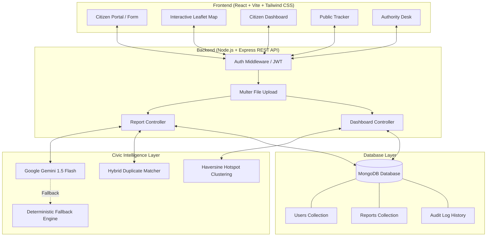

# CivicActionAI — From Complaints to Action

> **An AI-powered civic intelligence and municipal workflow platform transforming scattered, unstructured citizen reports into prioritized, explainable, and trackable public action.**
>
> Built for the **PromptWars x ASTRA | AI for Civic Impact** Hackathon.

[](https://github.com/Ayush-kotian/CivicActionAI)
[-brightgreen.svg)](https://github.com/Ayush-kotian/CivicActionAI)
[](https://github.com/Ayush-kotian/CivicActionAI)
[](https://github.com/Ayush-kotian/CivicActionAI)

---

## 1. Problem Statement

Communities encounter recurring, severe civic failures on a daily basis: road waterlogging, hazardous potholes, open manholes, overflowing garbage bins, broken streetlights, and broken water mains.

Today's municipal complaint handling suffers from critical breakdowns:
- **Scattered & Unstructured Reporting**: Citizens file emotional, text-heavy reports across disparate channels without structured categories or precise location data.
- **Duplicate Overload**: A single visible pothole or waterlogged arterial road triggers dozens of redundant complaints, overwhelming call centers and intake queues.
- **Hidden Emergencies**: Life-threatening safety hazards (e.g., live sparking wires near a playground or an open manhole near a school) get buried beneath routine cosmetic requests.
- **Recurring Blindspots & Lack of Hotspots**: Authorities treat each complaint as an isolated incident instead of recognizing chronic infrastructure failure clusters across neighborhoods.
- **Lack of Transparent Tracking**: Complaints vanish into an opaque administrative void. Citizens lose trust because they cannot track whether action was actually taken.

---

## 2. Solution: Capture → Understand → Reveal → Act

**CivicActionAI** re-engineers municipal issue management into a 4-phase closed-loop operational pipeline:

```
┌─────────────────┐     ┌─────────────────────┐     ┌─────────────────────┐     ┌──────────────────┐
│   1. CAPTURE    │ ──> │    2. UNDERSTAND    │ ──> │      3. REVEAL      │ ──> │      4. ACT      │
│  Citizen Auth,  │     │  AI Categorization, │     │  Geospatial Hotspot │     │  Dispatch Work,  │
│  Map Pin & Photo│     │  Priority & Summary │     │  & Duplicate Link   │     │  Citizen Tracking│
└─────────────────┘     └─────────────────────┘     └─────────────────────┘     └──────────────────┘
```

1. **CAPTURE**: Citizens authenticate securely and submit complaints with text, category options, photo attachments, and exact map-pinned coordinates.
2. **UNDERSTAND**: The AI pipeline analyzes the issue into validated structured JSON—summarizing core concerns, flagging life-safety hazards, and computing explainable priority scores with human-readable rationales.
3. **REVEAL**: The engine detects duplicate reports without deleting citizen evidence, clusters geospatial hotspots within 600 meters, and synthesizes 1-minute Action Briefs for department directors.
4. **ACT**: Municipal administrators assign work orders to responsible field departments, update progress along an immutable 5-stage lifecycle, and keep citizens continuously informed through private dashboards and public tracking IDs.

---

## 3. Key Features

- **Citizen Registration & Login**: Multi-field registration (`Name`, `Username`, `Phone`, `Email`, `Password` &ge; 6 characters, `Confirm Password`). Login via email or username.
- **Authenticated Complaint Submission**: Anonymous spam is eliminated; authenticated citizens file issues with auto-detected categories and photo attachments (&le; 5 MB).
- **Map-Based Location Selection**: Interactive OpenStreetMap/Leaflet map. Users click anywhere to place a marker or drag the marker to fine-tune exact latitude and longitude. No tedious address typing required.
- **AI-Powered Categorization**: Automatically categorizes issues into standard civic domains (`Waterlogging`, `Road Damage`, `Drainage`, `Waste Management`, `Streetlight`, `Public Safety`, `Water Supply`, `Public Transport`).
- **AI-Generated Complaint Summaries**: Distills rambling descriptions into clear, operational 1–2 sentence problem statements for field supervisors.
- **Hybrid Duplicate Complaint Detection**: Calculates a multi-factor duplicate confidence score ($0.50 \times \text{Text} + 0.35 \times \text{Distance} + 0.15 \times \text{Category}$).
- **Non-Deletion Guarantee**: Duplicate reports are **never deleted**. The new complaint is linked to the primary complaint as corroborating evidence.
- **Explainable Priority Scoring**: 0–100 priority score with plain-language bullet points explaining *why* an issue was prioritized (hazard severity, disruption, vulnerable locations).
- **Geospatial Hotspot Clustering**: Haversine clustering groups related issues within 600 meters into high-density incident zones.
- **1-Minute Executive Action Briefs**: Synthesized briefings summarizing root causes, affected radius, corroborating evidence, and recommended field directives.
- **Authority Dispatch Operations Console**: Central administrative desk for municipal officers to filter, search, inspect AI explainability, assign departments, and manage workflow transitions.
- **Work Order Assignment**: Department dispatch across 6 core municipal bodies (`Road Maintenance`, `Drainage`, `Waste Management`, `Electrical`, `Public Safety`, `Water Supply`).
- **5-Stage Complaint Lifecycle**: `SUBMITTED` &rarr; `UNDER REVIEW` &rarr; `ASSIGNED` &rarr; `IN PROGRESS` &rarr; `RESOLVED`.
- **Citizen Workspace (My Dashboard)**: Dedicated user dashboard showing only the citizen's own submitted complaints with real-time status badges and submission dates.
- **Public Complaint Tracking**: Instant status lookup by Complaint ID (`#CAI-XXXXX`) without login, showing a visual progress timeline and audit notes.

---

## 4. AI Capabilities & Deterministic Fallback

CivicActionAI uses **Google Gemini 1.5 Flash** (`@google/generative-ai`) with strict JSON schema constraints and low temperature ($T=0.2$).

| Capability | AI Function | Rule-Based / Algorithmic Function |
| :--- | :--- | :--- |
| **Categorization** | Maps informal citizen prose and colloquial slang to standard municipal categories. | Keyword dictionary fallback if API key is omitted. |
| **Summarization** | Extracts the root mechanical failure into an operational summary. | Truncated sentence boundary extractor. |
| **Priority Analysis** | Evaluates compounding risks (e.g. water accumulation near electrical transformer). | Mathematical formula weighting safety words + vulnerable areas. |
| **Explainable Reasoning**| Generates 2–4 plain-language bullet points justifying the priority score. | Deterministic checklist based on matched risk factors. |
| **Duplicate Detection** | Semantic sentence embedding similarity between incident descriptions. | Jaccard n-gram token similarity + Haversine distance. |
| **Hotspot Insights** | Synthesizes multi-report patterns into executive Action Briefs. | Spatial density clustering within 600m radius. |

### Deterministic Fallback Guarantee
If `GEMINI_API_KEY` is not configured, the network times out, or quota is exhausted, CivicActionAI switches **automatically and seamlessly** to its built-in deterministic civic intelligence pipeline. Every feature—including categorization, scoring, duplicate detection, and summaries—remains 100% operational.

---

## 5. User Roles & Access Control

```
+--------------------------------------------------------------------------------+
|                                 USER ROLES                                     |
+------------------------------------+-------------------------------------------+
| Citizen / User                     | Authority / Municipal Admin               |
| • Register & Sign In               | • Single Predefined Demo Admin (Rajesh)   |
| • Submit Complaints with Map Pin   | • Review All Citywide Complaints          |
| • View Personal Dashboard          | • Inspect AI Explainability & Evidence    |
| • Track Status & Progress Notes    | • Assign Departments & Add Dispatch Notes |
| • Blocked from Authority Console   | • Review & Confirm/Dismiss Duplicates     |
+------------------------------------+-------------------------------------------+
```

- **Citizen Access**: Ordinary citizens can only access `/report`, `/track`, and `/my-complaints`. The Authority Desk link is hidden from their navigation.
- **Authority Access**: Only authenticated administrators (`role: 'admin'`) can access the dispatch console and admin endpoints (`GET /api/reports`, `PATCH /assign`, `PATCH /status`, `PATCH /duplicate-status`). Unauthorized requests receive `403 Forbidden`.

---

## 6. Complaint Lifecycle

Every complaint transitions through an audit-logged 5-stage state machine:

```
[ SUBMITTED ] ───────────> [ UNDER REVIEW ] ───────────> [ ASSIGNED ]
 Citizen files issue        AI analysis complete          Department & lead officer
 with photo & coordinates   Duplicate check finished      delegated by authority
                                                               │
                                                               ▼
[ RESOLVED ]  <─────────────────────────────────────── [ IN PROGRESS ]
 Citizen tracking updated   Field crew deployed           Work crew on-site
 Inspection complete        Progress note logged          Repairs underway
```

1. **SUBMITTED**: Complaint stored in MongoDB, citizen receives `#CAI-XXXXX`.
2. **UNDER REVIEW**: AI analyzes priority, generates summary, checks for duplicates, and maps hotspots.
3. **ASSIGNED**: Municipal authority selects responsible department and assigns field supervisor.
4. **IN PROGRESS**: Field crew is dispatched; progress notes are appended to the public timeline.
5. **RESOLVED**: Work is inspected, photo evidence verified, and final resolution note recorded.

---

## 7. System Architecture



---

## 8. Technology Stack

| Layer | Technologies Used |
| :--- | :--- |
| **Frontend** | React 18, TypeScript, Vite 6, Tailwind CSS, Lucide React Icons |
| **Mapping & GIS** | Leaflet, React-Leaflet, OpenStreetMap Tile Service |
| **Backend API** | Node.js (v20+ / v22+), Express.js (ES Modules), Multer, Helmet, CORS |
| **Database** | MongoDB, Mongoose 8 (Local MongoDB or MongoDB Atlas) |
| **AI / LLM** | Google Gemini 1.5 Flash (`@google/generative-ai`), Custom Fallback Engine |
| **Testing** | Vitest, Supertest (27 automated tests) |
| **Security** | JSON Web Tokens (JWT), Bcrypt password hashing, Express Rate Limiter |

---

## 9. Location Handling

- **Interactive Map Pinning**: Powered by Leaflet and OpenStreetMap tiles.
- **Click-to-Place**: Clicking anywhere on the map places the marker.
- **Drag-to-Refine**: Dragging the marker adjusts the exact coordinates in real-time.
- **Automatic Binding**: Latitude and longitude fields update instantly and are submitted as numeric coordinates (`latitude`, `longitude`).
- **Coordinate Storage**: Coordinates are stored directly on the MongoDB `Report` document (`location.latitude`, `location.longitude`, `location.address`), enabling accurate Haversine distance computations.

---

## 10. Duplicate Detection & Non-Deletion Policy

CivicActionAI utilizes a transparent hybrid scoring formula:

$$\text{Duplicate Score} = (\text{Text Similarity} \times 0.50) + (\text{Geographic Proximity} \times 0.35) + (\text{Category Match} \times 0.15)$$

### Confidence Tiers
- **80% – 100% (Strong / Likely Duplicate)**: Close textual match, identical category, and within 200 meters.
- **60% – 79% (Possible Duplicate)**: Moderate text overlap or same neighborhood cluster (&le; 600 meters).
- **Below 60% (Distinct Issue)**: Processed as an independent complaint.

### Strict Non-Deletion Guarantee
- **Never Deleted**: Both complaints are preserved in full. Corroborating citizen evidence is vital to proving problem severity.
- **Linked Records**: The new complaint records `duplicateOf: "CAI-XXXXX"` and `duplicateConfidence: 0.88`.
- **Authority Review**: On the Authority Desk, administrators review linked duplicates and can confirm or dismiss the duplicate relationship with one click.

---

## 11. Priority Scoring & Explainability

Priority is calculated on a 0–100 scale mapping to 4 distinct priority tiers:

| Tier | Score Range | Criteria | Example |
| :--- | :---: | :--- | :--- |
| **CRITICAL** | 80–100 | Severe life safety hazard, electrical danger, hospital/school disruption | Open manhole near elementary school, live sparking power cable |
| **HIGH** | 60–79 | Major arterial blockage, severe flooding, multi-lane road collapse | Waterlogging submerging Ring Road metro intersection |
| **MEDIUM** | 35–59 | Moderate disruption, foul odor, non-hazardous service interruptions | Overflowing community waste bin, single dark streetlight |
| **LOW** | 0–34 | Minor cosmetic issues, non-urgent public requests | Faded crosswalk paint, small curb chip |

### Explainability Bullet Points
Every complaint record displays human-readable reasons explaining the score:
- *Identified life-safety hazard keyword: open manhole*
- *High-density pedestrian corridor: 50m from school zone*
- *Severe disruption risk to local vehicular traffic*

---

## 12. Authority Dashboard & Hotspot Insights

- **Real-Time KPIs**: Active counters for Total Complaints, Critical/High Priority, Pending Assignment, In Progress, and Resolved Issues.
- **Interactive Geospatial Map**: Renders all citywide reports with color-coded priority pins (`CRITICAL` = Red, `HIGH` = Amber, `MEDIUM` = Blue, `LOW` = Slate).
- **Hotspot Clustering**: Groups incidents within 600 meters using Haversine distance. Identifies chronic infrastructure failures (e.g. 8 complaints along Main Road).
- **Action Brief Modal**: Synthesizes clustered reports into an executive briefing with affected radius, root cause analysis, and suggested resource mobilization.
- **Multi-Filter Console**: Instant filtering by Category, Priority, Lifecycle Status, Department, or Duplicates Only, plus debounced text search.

---

## 13. Demo Credentials

The platform includes a dedicated, predefined single demo administrator account for hackathon evaluation:

> [!IMPORTANT]
> ### 🔴 Demo Authority Account (Use for Demo)
> - **Username / Email**: `rajesh@gmail.com` *(or username: `rajesh`)*
> - **Password**: `123456`
> - **Role**: `admin`
>
> *Note: These are synthetic demo credentials for evaluation only. Login fields are intentionally left blank (no auto-fill). The evaluator can type or copy/paste the credentials into the Authority Login form.*

---

## 14. Installation & Setup

### Prerequisites
- **Node.js** (v18.0.0 or higher; v20/v22 recommended)
- **npm** (v9.0.0 or higher)
- **MongoDB** running locally on port 27017 (`mongodb://127.0.0.1:27017`) or a free MongoDB Atlas connection URI

### Step-by-Step Setup

```bash
# 1. Clone the repository
git clone https://github.com/Ayush-kotian/CivicActionAI.git
cd CivicActionAI

# 2. Install root and workspace dependencies
npm install
npm install --prefix server
npm install --prefix client

# 3. Configure server environment variables
cp .env.example server/.env

# 4. Seed synthetic demonstration data (35 realistic civic reports)
npm run seed

# 5. Start the development servers
# Terminal 1: Backend API (runs on http://localhost:5000)
npm run server

# Terminal 2: Frontend App (runs on http://localhost:5173)
npm run client
```

Open [http://localhost:5173](http://localhost:5173) in your browser.

---

## 15. Environment Variables

Create a `server/.env` file based on `.env.example`:

| Variable | Required | Description | Default / Example |
| :--- | :---: | :--- | :--- |
| `PORT` | No | Server listener port | `5000` |
| `NODE_ENV` | No | Application environment | `development` |
| `MONGODB_URI` | No | MongoDB connection string | `mongodb://127.0.0.1:27017/civicactionai` |
| `JWT_SECRET` | No | Secret key for JWT signing | `civicactionai_jwt_secret_dev_key_2026` |
| `GEMINI_API_KEY` | Optional | Google Gemini API key from AI Studio | *Fallback active if omitted* |
| `CLIENT_ORIGIN` | No | Allowed frontend CORS origin | `http://localhost:5173` |

> [!NOTE]
> No real API keys, passwords, or production secrets are stored in this repository or committed to GitHub.

---

## 16. Sample & Demo Data

CivicActionAI includes a built-in synthetic database seeder generating **35 realistic municipal complaints**:
- Realistic addresses across commercial corridors, residential avenues, and transit circles.
- Deliberate duplicate pairs with identical/near-identical text and coordinates.
- A high-density waterlogging hotspot on Main Road (8 linked reports).
- Critical safety hazards (open manhole, sparking electrical transformer).
- **100% Synthetic**: Contains zero personally identifiable information (PII) or real citizen data.

Run the seeder anytime:
```bash
npm run seed
```

---

## 17. Automated Testing

CivicActionAI features an automated test suite executed with Vitest:

```bash
npm test --prefix server
```

### Test Suite Coverage (27 / 27 Tests Passed)
- **`tests/hotspot.test.js`** (1 test): Geospatial Haversine clustering, incident density, Action Brief generation.
- **`tests/duplicate.test.js`** (6 tests): Strong duplicate scoring (&ge; 80%), possible duplicate scoring (60–79%), non-duplicate separation, coordinate fallback, and explainable reasons checklist.
- **`tests/aiFallback.test.js`** (4 tests): Deterministic categorization, hazard pattern matching, vulnerable area weighting, and priority scoring.
- **`tests/api.test.js`** (16 tests): Citizen signup, login, demo admin login, 403 Forbidden role enforcement, authenticated complaint filing, `my-reports` citizen isolation, department assignment, status transitions, duplicate review, and public tracking.

---

## 18. Security & Access Control

- **Role-Based Access Control (RBAC)**: Backend routes strictly enforce `citizen` vs `admin` roles. Ordinary citizen accounts receive `403 Forbidden` if attempting to query or modify admin endpoints.
- **Password Hashing**: Passwords are encrypted using `bcrypt` (10 salt rounds) before persistence.
- **Stateless Authentication**: Verified via signed JSON Web Tokens (`Bearer <token>`).
- **Citizen Data Isolation**: The `GET /api/reports/my-reports` endpoint strictly queries reports where `citizenId == req.user._id`.
- **Upload Security**: Multer file filter allows only `image/jpeg`, `image/png`, and `image/webp` with a 5 MB file size limit and randomized storage names.
- **Input Sanitization**: Request bodies are validated for coordinate bounds and description lengths.
- **Prompt-Injection Defense**: User inputs are demarcated as untrusted citizen data (`--- UNTRUSTED CITIZEN REPORT ---`), preventing jailbreak instructions from manipulating system behavior.

---

## 19. Accessibility & Responsive Design

- **WCAG AA Compliance**: High-contrast typography adhering to WCAG AA contrast ratios across all backgrounds.
- **Non-Color Indicators**: Every priority badge and status badge combines distinct icons, explicit labels, and distinct color schemes so information is never conveyed by color alone.
- **Keyboard Navigation**: Form inputs, buttons, and modals support standard Tab, Enter, and Escape keys with visible focus rings.
- **Mobile-First Layout**: Fully responsive layouts using Tailwind CSS. The Leaflet map touch-controls are optimized for both mobile devices and desktop viewports.

---

## 20. Limitations & Honesty Note

In accordance with hackathon evaluation standards:
- **Genuine & Implemented**:
  - Live MongoDB database persistence and Express REST API.
  - Live Google Gemini API structured output generation with deterministic fallback.
  - Real hybrid duplicate detection scoring formula and non-deletion linkage.
  - Real geospatial Haversine clustering and Action Brief synthesis.
  - Real 5-stage status lifecycle with immutable audit histories.
  - Real authenticated citizen portal and public tracking page.
- **Simulated / Mocked Integrations**:
  - Department dispatching is modeled within the application's internal MongoDB database; there is no live integration with external municipal ERP systems (e.g. SAP/Cityworks).
  - External emergency 911/112 dispatch is simulated.
  - Map imagery uses free OpenStreetMap tile layers without paid commercial geocoding APIs.
- **AI Probabilistic Nuance**: AI categorization and summarization can occasionally misinterpret ambiguous local slang; municipal authorities retain full manual override control over all fields.

---

## 21. Hackathon Alignment: Capture → Understand → Reveal → Act

| Challenge Requirement | How CivicActionAI Solves It | Implemented Verification |
| :--- | :--- | :---: |
| **Capture Complaints** | Authenticated form with text, categories, photo upload, and interactive map marker. | Verified (`POST /api/reports`) |
| **Understand Issues** | AI summarizes core issue, flags hazards, and outputs explainable priority rationales. | Verified (`geminiService.js` + Fallback) |
| **Reveal Patterns** | Detects duplicates without deleting evidence; clusters hotspots within 600m. | Verified (`duplicateService.js` + `hotspotService.js`) |
| **Drive Action** | Authority Desk enables department assignment, status updates, and public tracking. | Verified (`CitizenTrack.tsx` + `AdminDashboard.tsx`) |

---

## 22. Repository & Verification Summary

- **Repository**: [https://github.com/Ayush-kotian/CivicActionAI](https://github.com/Ayush-kotian/CivicActionAI)
- **Branch**: Exactly **1 branch** (`main`)
- **Remote Branches**: `origin/main` (Count: 1)
- **Repository Size**: &lt; 500 KiB (Zero node_modules, build caches, or secrets committed)
- **Audit Table**: See [IMPLEMENTATION_CHECKLIST.md](./IMPLEMENTATION_CHECKLIST.md)
- **Requirement Traceability**: See [REQUIREMENT_MATRIX.md](./REQUIREMENT_MATRIX.md)
